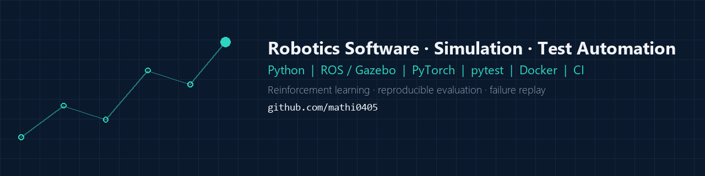

  

<h2 align="center">Hi, I'm Mani Chandan Mathi</h2>

  <b>M.Eng. Robotics student</b> at Deggendorf Institute of Technology (Cham, Germany) · B.Tech. Computer Science and Engineering 
  I build and test robot software in simulation, and I measure it: frozen test suites, failure replay and release gates.

  
  
  
  

---

### 🔭 Featured work

| Project | Result | Stack |
|---|---|---|
| [**Driving-controller validation platform**](https://github.com/mathi0405/Autonomous-driving) | Paired CPU-simulation scenarios (nominal, geometry, sensing, actuator faults) with failure replay and release gates. v6 completed **501/512** missions vs 492/512 for v5; the remaining 11 failures keep the release gate closed. | Python · pytest · Docker · CI |
| [**TurtleBot navigation with SAC**](https://github.com/mathi0405/deep_rl_turtlebot_nav) | Train-checkpoint-evaluate pipeline with 25 tests. Three policies scored **50/50, 48/50, 47/50** on a frozen suite; the best transferred to a ROS1 Noetic **Gazebo** world at **19/20**. CI builds the Gazebo container on every change. | PyTorch · ROS · Gazebo · Docker · GitHub Actions |
| [**Swarm-SAR**](https://github.com/mathi0405/drone-swarm-sar) | Cooperative drone search-and-rescue simulation: multi-agent RL (CTDE MAPPO), communication ablations, task-allocation baselines and fault injection. | Python · NumPy · PyTorch · ROS 2 node |
| [**Lane detection (TuSimple)**](https://github.com/mathi0405/tusimple_lane_detection) | UNet lane segmentation with polynomial lane fitting and a smoothed centre path for video; CPU smoke tests in CI. | PyTorch · OpenCV · pytest |

**Research:** IEEE conference paper (2023) on isolated sign-language recognition · Raspberry Pi IMU gesture recognition with [TensorFlow Lite](https://github.com/mathi0405/Motion-Detection-lab).

### 🛠️ Toolbox

### 🧭 How I work
- **Measure before claiming:** every result above comes from a frozen evaluation suite that can be re-run.
- **Keep failures visible:** collisions, timeouts and failed seeds stay in the reports and drive the next change.
- **Automate the checks:** tests, containers and CI on every change, so results stay reproducible.

### 🌱 Currently
- Writing a ROS 2 package in C++, test-first (GoogleTest)
- Learning aerial robotics with ROS 2 (Coursera)
- German: A2 course completed, certificate exam next, then B1

<i>Looking for working-student roles and internships in robotics software, simulation & test automation, computer vision or applied AI. Happy to talk!</i>

